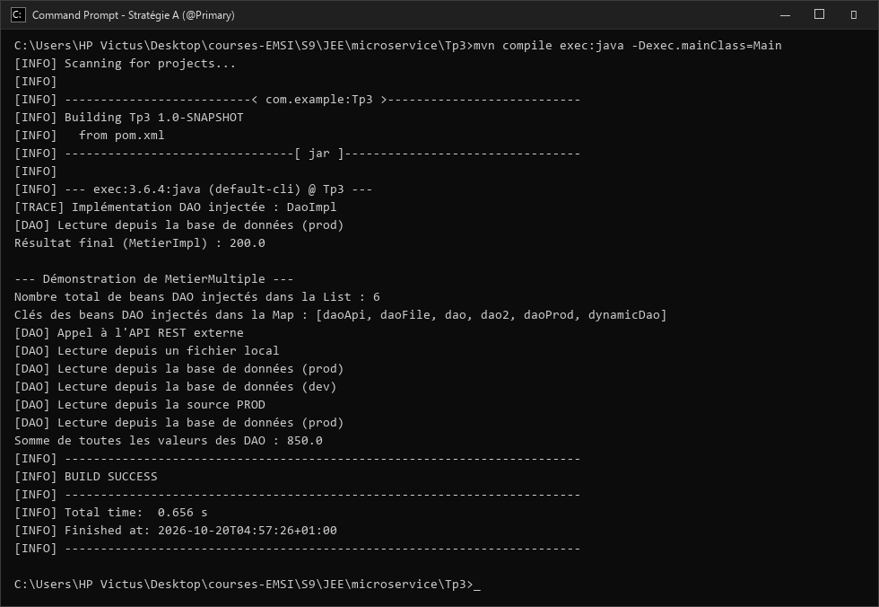
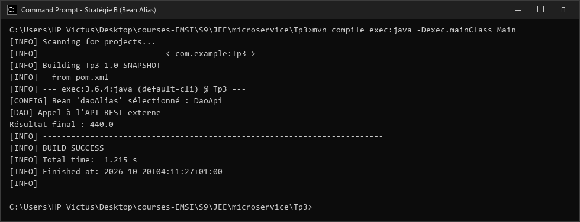
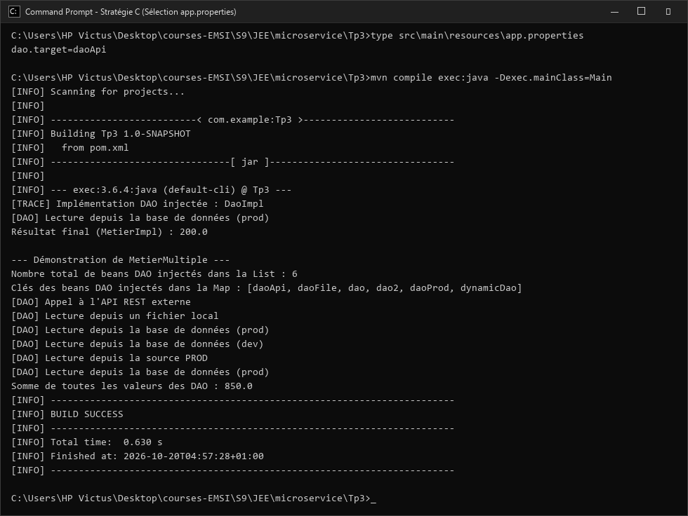
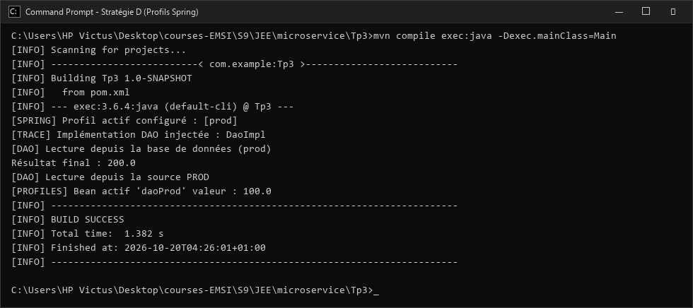
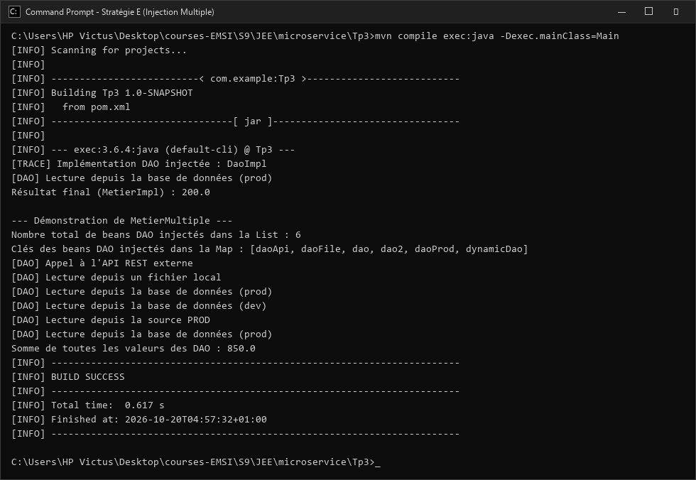
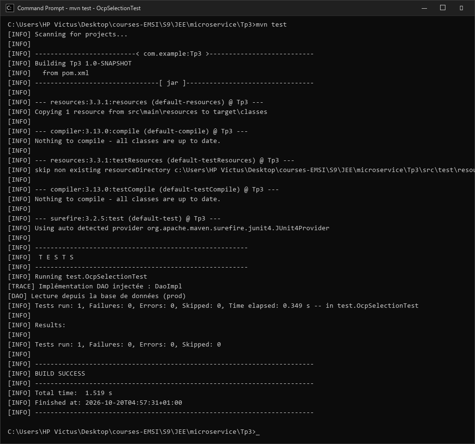

# TP3 : Spring IoC & OCP - Stratégies d'Injection et Sélection d'Implémentations

Ce projet illustre de manière approfondie les mécanismes d'**Inversion de Contrôle (IoC)** et d'**Injection de Dépendances (DI)** offerts par le conteneur Spring Framework, ainsi que le respect des principes **SOLID**, en particulier le principe **OCP (Open/Closed Principle)** et le **DIP (Dependency Inversion Principle)**.

---


## 1. Architecture & Organisation du Projet

Le projet adopte une structure Maven standardisée séparant rigoureusement les contrats d'interface, les implémentations et les configurations :

```text
Tp3/
├── pom.xml
├── README.md
├── screenshots/                     # Captures d'écran réelles d'exécution
│   ├── 01_strategie_a_primary.png
│   ├── 02_strategie_b_bean_alias.png
│   ├── 03_strategie_c_properties.png
│   ├── 04_junit_ocp_test.png
│   ├── 05_spring_profiles.png
│   └── 06_multiple_dao_injection.png
└── src/
    ├── main/
    │   ├── java/
    │   │   ├── Main.java            # Point d'entrée principal de l'application
    │   │   ├── config/
    │   │   │   ├── AppConfig.java         # Configuration centrale (@ComponentScan, @PropertySource)
    │   │   │   ├── DaoAliasConfig.java    # Stratégie B : Déclaration de bean alias
    │   │   │   └── DynamicDaoConfig.java  # Stratégie C : Sélection dynamique via @Value
    │   │   ├── dao/
    │   │   │   ├── IDao.java              # Interface contrat DAO
    │   │   │   ├── DaoImpl.java           # Version Base de données (Prod)
    │   │   │   ├── DaoImpl2.java          # Version Base de données (Dev / Capteurs)
    │   │   │   ├── DaoFile.java           # Version Fichier local
    │   │   │   ├── DaoApi.java            # Version Appel API REST externe
    │   │   │   ├── DaoImplProd.java       # Version Profil "prod"
    │   │   │   └── DaoImplDev.java        # Version Profil "dev"
    │   │   └── metier/
    │   │       ├── IMetier.java           # Interface contrat Métier
    │   │       ├── MetierImpl.java        # Implémentation Métier (Injection par constructeur)
    │   │       └── MetierMultiple.java    # Extension : Injection de List<IDao> et Map<String, IDao>
    │   └── resources/
    │       └── app.properties             # Fichier externe de configuration clé/valeur
    └── test/
        └── java/
            └── test/
                └── OcpSelectionTest.java  # Test JUnit validant le principe OCP
```

---

## 2. L'Abstraction Fondamentale : Couplage Faible

Le cœur de l'architecture repose sur l'interface `IDao`, contrat unique partagé par toutes les sources de données :

```java
package dao;

public interface IDao {
    /**
     * Récupère une valeur numérique depuis la source de données.
     * @return la valeur récupérée
     */
    double getValue();
}
```

### Diversité des Implémentations

| Classe | Annotation | Description | Valeur retournée |
| :--- | :--- | :--- | :--- |
| `DaoImpl` | `@Component("dao")` | Simulation d'une base de données de production | `100.0` |
| `DaoImpl2` | `@Component("dao2")` | Simulation d'une base de données de développement | `150.0` |
| `DaoFile` | `@Component("daoFile")` | Lecture depuis un fichier local | `180.0` |
| `DaoApi` | `@Component("daoApi")` | Consommation d'un service web / API REST | `220.0` |
| `DaoImplProd` | `@Component("daoProd") @Profile("prod")` | Source active uniquement sous le profil `prod` | `100.0` |
| `DaoImplDev` | `@Component("daoDev") @Profile("dev")` | Source active uniquement sous le profil `dev` | `80.0` |

---

## 3. La Couche Métier & Immuabilité

La classe `MetierImpl` implémente `IMetier`. Elle applique les meilleures pratiques logicielles :
- **Injection par constructeur** avec un attribut `private final IDao dao;` pour garantir l'immuabilité et la présence obligatoire de la dépendance.
- **Journalisation `@PostConstruct`** pour tracer dynamiquement le bean réel injecté lors de l'initialisation du conteneur.

```java
package metier;

import dao.IDao;
import org.springframework.context.annotation.Primary;
import org.springframework.stereotype.Service;
import javax.annotation.PostConstruct;

@Primary
@Service
public class MetierImpl implements IMetier {
    private final IDao dao;

    public MetierImpl(IDao dao) {
        this.dao = dao;
    }

    @PostConstruct
    public void init() {
        System.out.println("[TRACE] Implémentation DAO injectée : " + dao.getClass().getSimpleName());
    }

    @Override
    public double calcul() {
        return dao.getValue() * 2.0;
    }
}
```

---

## 4. Stratégies d'Injection et de Sélection

Spring propose plusieurs mécanismes élégants pour résoudre l'ambiguïté lorsqu'une interface dispose de multiples implémentations.

### Stratégie A : Utilisation de `@Primary`
- **Principe** : L'annotation `@Primary` indique à Spring quel composant privilégier par défaut lorsqu'aucun qualificateur explicite n'est précisé.
- **Code** :
```java
@Primary
@Component("dao")
public class DaoImpl implements IDao {
    @Override
    public double getValue() {
        System.out.println("[DAO] Lecture depuis la base de données (prod) - PRIMARY");
        return 100.0;
    }
}
```
- **Capture d'écran de l'exécution :**



---

### Stratégie B : Alias dynamique via `@Bean`
- **Principe** : Centraliser le choix dans une classe de configuration via une méthode `@Bean @Primary`. Permet de changer la source cible sans toucher aux classes DAO concrètes.
- **Code (`DaoAliasConfig.java`)** :
```java
@Configuration
public class DaoAliasConfig {
    @Bean
    @Primary
    public IDao daoAlias() {
        // Redirige vers l'implémentation API sans modifier les classes DAO
        return new DaoApi();
    }
}
```
- **Capture d'écran de l'exécution :**



---

### Stratégie C : Sélection externe par Fichier de Propriétés
- **Principe** : Flexibilité maximale **zéro recompilation**. Le choix de l'implémentation est externalisé dans `src/main/resources/app.properties`.
- **Fichier `app.properties`** :
```properties
dao.target=daoApi
```
- **Configuration dynamique (`DynamicDaoConfig.java`)** :
```java
@Configuration
@PropertySource("classpath:app.properties")
public class DynamicDaoConfig {

    @Value("${dao.target}")
    private String daoTarget;

    @Bean
    public static PropertySourcesPlaceholderConfigurer propertySourcesPlaceholderConfigurer() {
        return new PropertySourcesPlaceholderConfigurer();
    }

    @Bean
    @Primary
    public IDao dynamicDao() {
        switch (daoTarget) {
            case "dao": return new DaoImpl();
            case "dao2": return new DaoImpl2();
            case "daoFile": return new DaoFile();
            case "daoApi": return new DaoApi();
            default: throw new IllegalArgumentException("Cible DAO inconnue: " + daoTarget);
        }
    }
}
```
- **Capture d'écran de l'exécution :**



---

### Stratégie D : Gestion des Profils Spring (`@Profile`)
- **Principe** : Conditionner l'enregistrement des beans selon l'environnement actif (`dev`, `prod`, `test`).
- **Code (`DaoImplProd.java`)** :
```java
@Component("daoProd")
@Profile("prod")
public class DaoImplProd implements IDao {
    @Override
    public double getValue() {
        System.out.println("[DAO] Lecture depuis la source PROD");
        return 100.0;
    }
}
```
- **Activation dans `Main.java`** :
```java
AnnotationConfigApplicationContext context = new AnnotationConfigApplicationContext();
context.getEnvironment().setActiveProfiles("prod");
context.register(AppConfig.class);
context.refresh();
```
- **Capture d'écran de l'exécution :**



---

### Stratégie E : Injection Multiple (`List` & `Map` de DAO)
- **Principe** : Lorsqu'une couche métier doit composer avec toutes les sources simultanément, Spring injecte l'ensemble des beans sous forme de collection (`List<IDao>`) ou de dictionnaire (`Map<String, IDao>`).
- **Code (`MetierMultiple.java`)** :
```java
@Service
public class MetierMultiple implements IMetier {
    private final List<IDao> daos;
    private final Map<String, IDao> daoMap;

    public MetierMultiple(List<IDao> daos, Map<String, IDao> daoMap) {
        this.daos = daos;
        this.daoMap = daoMap;
    }

    @Override
    public double calcul() {
        return daos.stream().mapToDouble(IDao::getValue).sum();
    }
}
```
- **Capture d'écran de l'exécution :**



---

## 5. Validation & Test de Non-Régression (JUnit)

Pour garantir le respect du principe **OCP (Open/Closed Principle)**, un test unitaire automatisé vérifie que le changement de source via `app.properties` impacte le résultat sans modification du code métier :

```java
package test;

import metier.IMetier;
import org.junit.Test;
import org.springframework.context.annotation.AnnotationConfigApplicationContext;
import config.AppConfig;
import static org.junit.Assert.assertEquals;

public class OcpSelectionTest {

    @Test
    public void testDaoImplParDefaut() {
        AnnotationConfigApplicationContext context = 
            new AnnotationConfigApplicationContext(AppConfig.class);
        IMetier metier = context.getBean(IMetier.class);
        
        // Si dao.target=dao, le résultat attendu est 200.0 (100.0 * 2)
        assertEquals(200.0, metier.calcul(), 0.001);
        
        context.close();
    }
}
```

- **Validation du test sous Maven :**



---

## 6. Guide d'Exécution

### Prérequis
- **Java JDK 17** ou **Java JDK 21**
- **Apache Maven 3.8+**

### Commandes Utiles

```bash
# Compiler l'ensemble du projet
mvn clean compile

# Lancer la suite de tests unitaires
mvn test

# Exécuter l'application principale
mvn exec:java "-Dexec.mainClass=Main"
```
